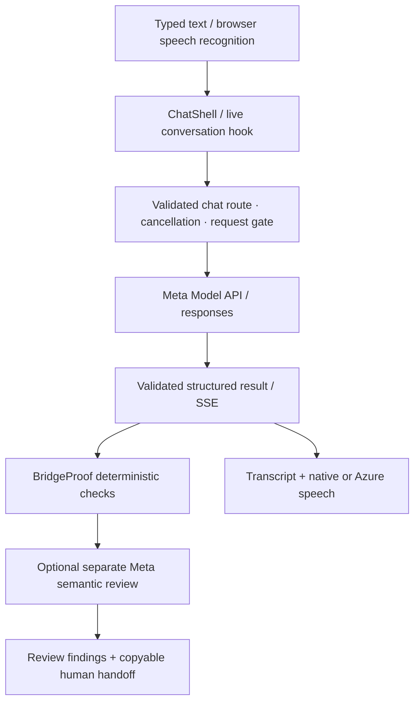
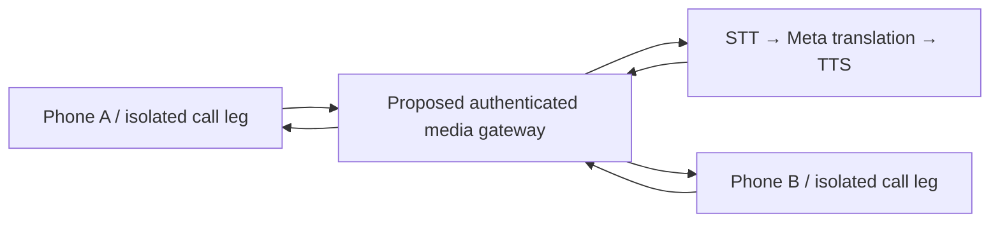

# BridgeVoice 3.0 architecture

## Implemented application flow

`use-live-conversation.ts` owns continuous turns, cancellation epochs, interruption handling and playback triggers. `VoiceConversation.tsx` renders controls; `VoiceBridge.tsx` renders existing brand paths and uses an optional microphone analyser solely for visual amplitude. Recognition is a separate browser service; the analyser is not the recognition transport. Browser services may process speech remotely. Neither layer stores audio in this app.

The source/target direction and participant identity are explicit in BridgeMode. A single microphone never supplies independent speaker channels. Typing remains available when recognition is unsupported. Native installed voices or the existing configured Azure route supply speech; Meta supplies text reasoning/translation, not direct audio.

The existing Meta adapter retains endpoint/model configuration, Zod result validation, context limits, streaming, cancellation, latency and usage data. Translation instructions now explicitly preserve identifiers, units and instructions. Model-generated text is never used as deterministic proof of correctness. Semantic review is a separate request to the same model family, not an independent authority.

BridgeProof layers checks for numerals, negation, unit bindings, numeric dates/times, currency, labeled identifiers, limited English names/instructions and possible omissions. Exact supporting passages remain visible. A material warning raises the review state. High-risk keywords raise human review even if patterns match. The checks cannot establish semantic equivalence.

## Telephone design — not a working media gateway

The future gateway must route A's translated output only to B, and B's only to A. This diagram is a design, not deployed infrastructure. Current code supplies a pure simulation reducer and a REST provider adapter; all public call creation remains blocked. No WSS audio gateway, phone STT/TTS pipeline, distributed call registry, interpreter dispatch or actual conference routing is implemented.

## Storage and boundaries

Chat history remains opt-in browser-local storage; glossary/preferences retain existing behavior. Voice turns appear in the current transcript even with persistence disabled. Simulation data is component state and resets on navigation. Server keys are environment-only. Existing request admission is process-local (30 requests/minute and three concurrent); distributed controls are required before scaling. The copyable handoff is user initiated; it does not transmit to an interpreter. No audio recordings or patient data are bundled.
